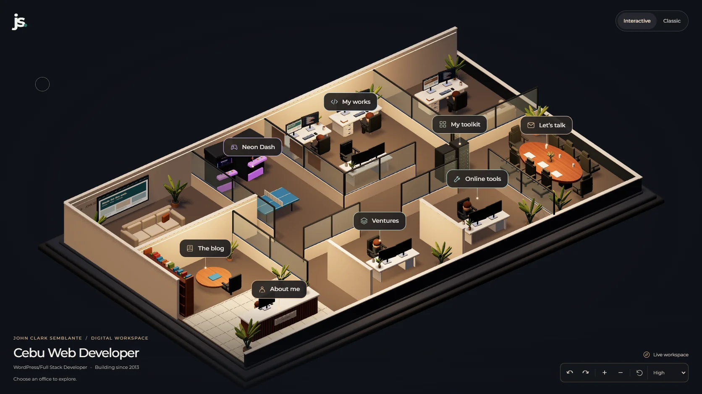
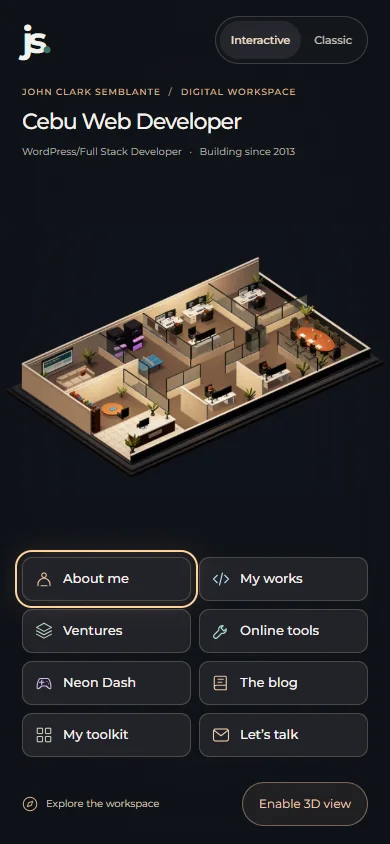
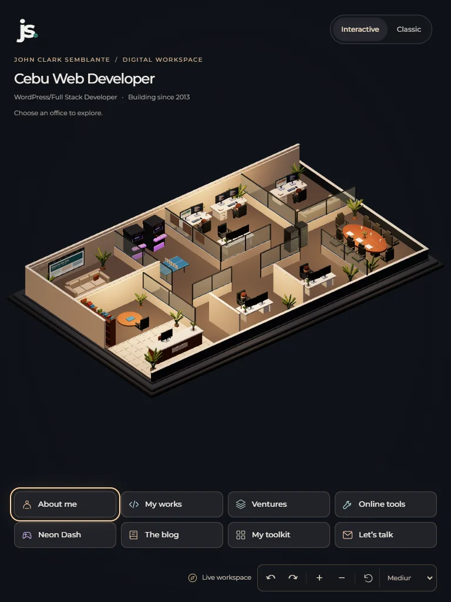

# Immersive office development review, 27 November 2026

This revision belongs to `feature/interactive-office`. Production remains Classic on `main`; no production build or deployment was run. The publishing workflow filters main pushes and now guards the publish job against other branch refs, including manual selection. See [development setup](../production-classic.md).

## Changes reviewed

- Shared Classic `js.` logo, floating top-left in Interactive.
- Full-screen office homepage without conventional header, footer, chat, theme switch or lower sections. Classic restores all traditional content and destination pages retain their shell.
- Building-only scene without exterior basketball court, roads or cars; matching regenerated previews and anchors.
- Bounded pointer tilt, room-focus tilt and eased return, disabled by reduced motion. Rendering settles to idle.
- Top-right presentation switch and eight real destination anchors opening existing room panels, with native dialog focus behavior and direct no-JavaScript navigation.

## Evidence

All 41 focused Node tests passed across office policy/content, Pages, SEO, handbook, dashboard and publishing configuration. TypeScript passed. The browser helper completed 27 checks in local Edge against the development server, covering 320, 390, 768, 1024, 1440 and 1672px widths, room panels, keyboard restoration, pointer tilt, mode persistence, pending-scene cancellation, hidden-tab/idle rendering, context loss, blocked storage, failed graphics/chunks and no-JavaScript links. No uncaught homepage errors occurred. Scoped axe checks reported zero WCAG A/AA violations for desktop, the Works panel and phone; this is not a full accessibility audit.

The scene fixture measured 75 draw calls, 267,508 triangles, 38 geometries and 13 textures at High. Desktop/mobile AVIF files are 42,868/12,000 bytes, WebP 91,506/21,942 bytes. These local measurements do not replace production Lighthouse or field data. The previous validation record describes the older design and retains its historical limitations.

A repeated browser run timed out enabling phone 3D while source edits were being made during development. A clean run after edits settled passed the full suite, including that check. Screenshots below were reviewed after transitions settled; the dev-only Next.js indicator is hidden by the screenshot helper.

## Production boundary and release limits

The live homepage returned HTTP 200 with `portrait-hero`, one Cebu Web Developer H1, its existing canonical and no office or mode controls. Remote main remained `8f2657119496baf30fb09765620e4ce0c9abc489` before the feature push. No workflow was dispatched.

Interactive now exposes compact identity and navigation links in initial HTML; long introduction and conventional sections belong to Classic. Review this content change in the final export before approving a release. This revision does not claim parity with the reference's offline rendering, improved field performance or search rankings. The earlier dependency advisory remains a separate release-maintenance concern documented in the historical review.
